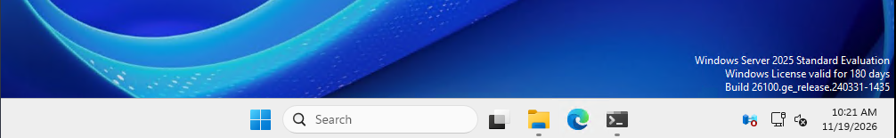

# Active Status

  

Get daily Windows server and workstation activation status in the amount of days remaining for the trial period. The server daemon sends email notifications to a desired address from your personal SMTP server.

Frequent testing of Windows machines will have a lot of them looking like this:

Eval period machines will often slip into regular production use and, often at the very worst time, will expire and begin intermittently shutting down. To prevent this, it's a good idea to keep an eye on your machines -- this gets far more difficult when you admin hundreds of servers. That's what this tool sets out to remedy.

For info on the server-side daemon, go [to the README here](server/SERVER.md). For info on the client-side, go [to the README here](client/CLIENT.md).
